<p align="center"></p>

<h1 align="center">Maine Cozy Cribbage</h1>

Two-player cribbage on hand-carved Maine boards, for Android phones and **foldables**. Play the computer, learn the
game with interactive lessons, or play friends live or turn by turn.

**[Download the latest APK](../../releases/latest)**: `MaineCozyCribbage-x.y.z-android.apk`. Once installed, the game
finds newer releases itself and offers **Update now** on its title screen.


| Title | Playing | Counting the show |
|---|---|---|
| 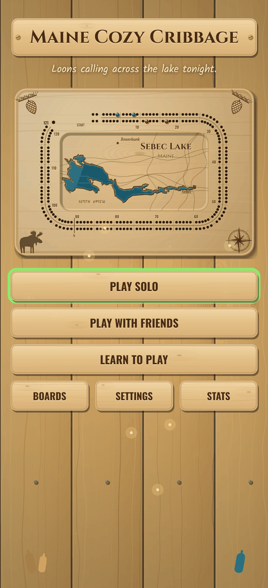 | 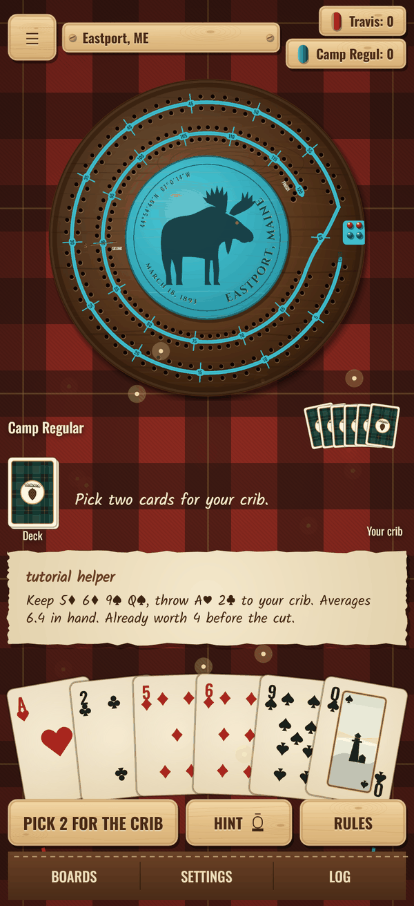 |  |

| Unfolded foldable | Half-folded (tabletop) |
|---|---|
| 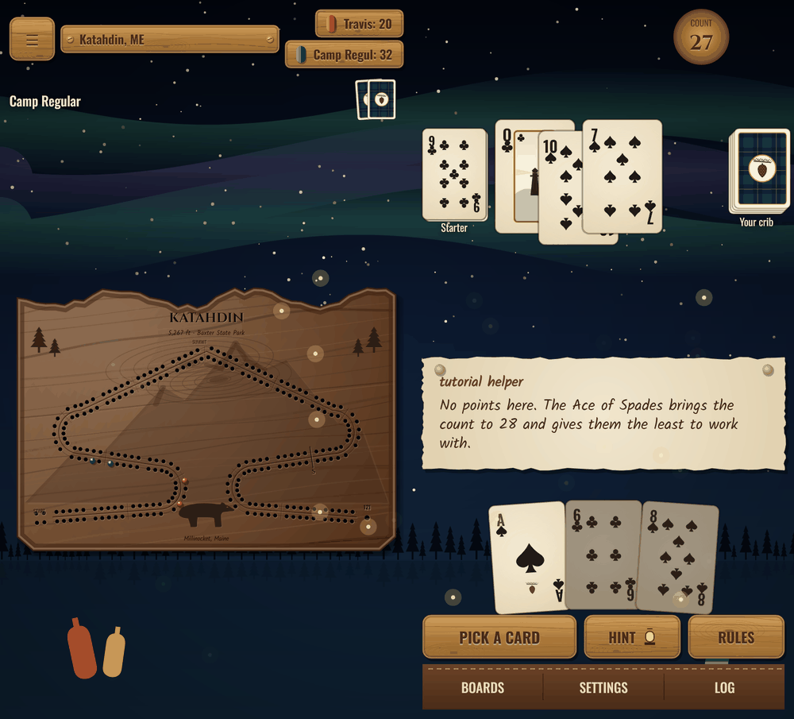 | 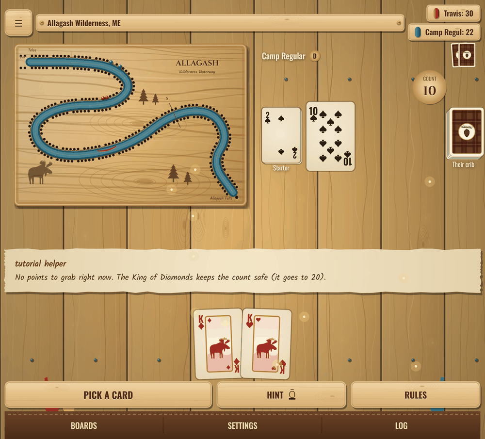 |

| Christmas | Fourth of July | Blueberry season | Halloween |
|---|---|---|---|
| 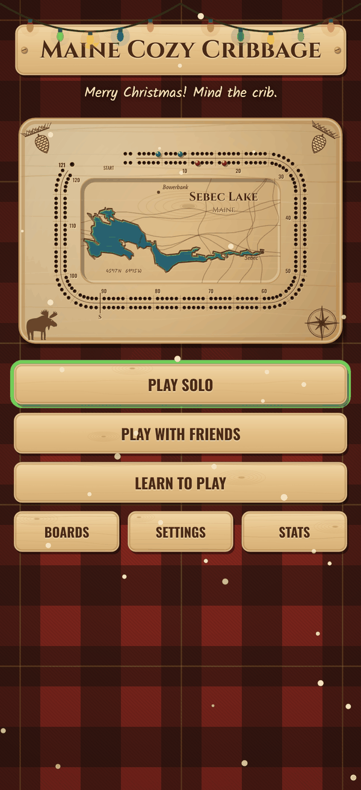 | 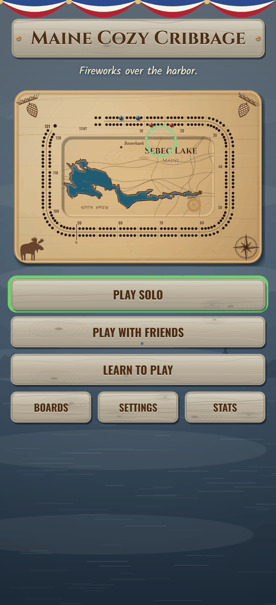 |  | 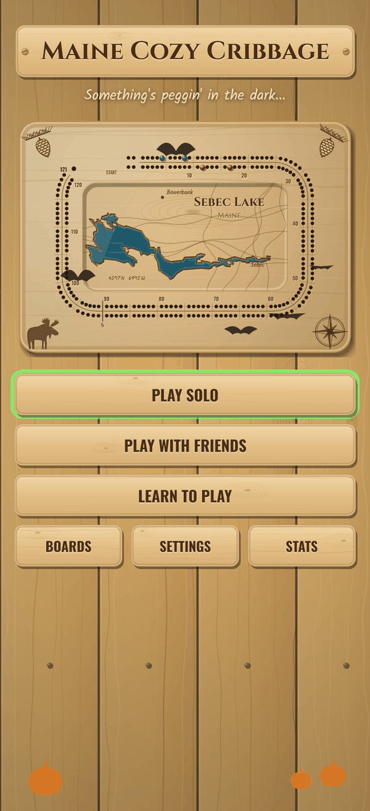 |

| Learn to play | Pegging lesson | Play with friends |
|---|---|---|
|  | 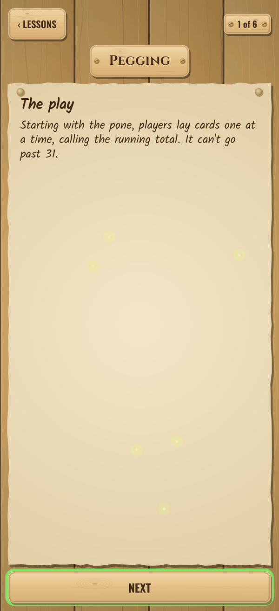 |  |

### The boards

| | |
|---|---|
| 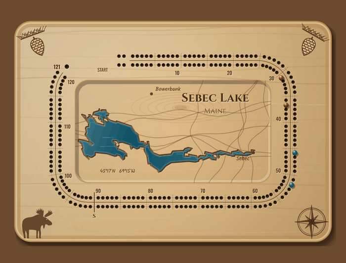 **Sebec Lake** · hard maple, racetrack round the map | 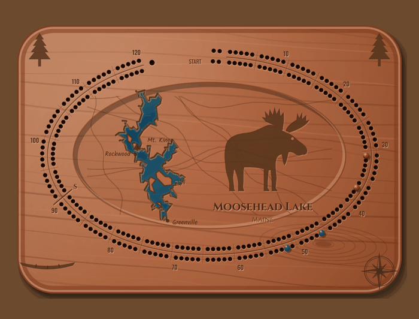 **Moosehead Lake** · black cherry, oval track and a bull moose |
|  **Schoodic Lake** · the lake inside a walnut brook trout |  **Eastport** · round and teal, two rings of track |
| 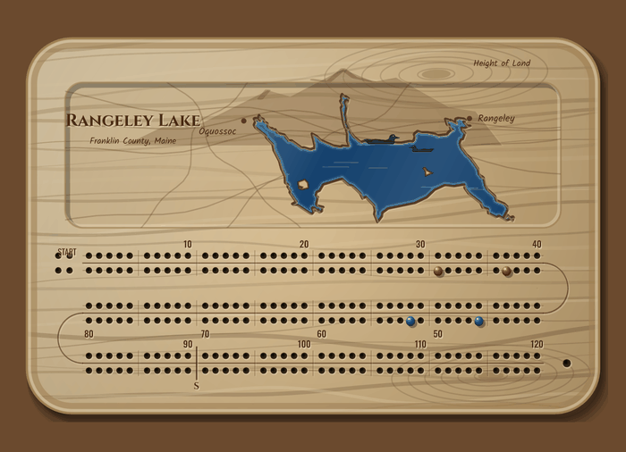 **Rangeley Lake** · three streets under Saddleback |  **Sebago Lake** · the track follows the shoreline |
|  **Bar Harbor** · Mount Desert Island in a poured sea |  **Katahdin** · switchbacks to the summit |
|  **Camden Harbor** · rolling waves and windjammers |  **Allagash Wilderness** · one bank each down the river |

All of these are rendered by the game's own code (`./gradlew :shared:desktopTest` writes them to `shared/build/screenshots`).

## What's in it

* **Ten boards, all Maine lakes and towns**: Sebec Lake, Moosehead Lake, Schoodic Lake (in a brook trout), Eastport
  (round and teal, after a real hand-made board), Rangeley Lake (three streets), Sebago Lake (the track follows its
  shoreline), Bar Harbor (Mount Desert Island raised out of a poured sea), Katahdin (switchbacks up the mountain),
  Camden Harbor (rolling waves and windjammers) and the Allagash (one bank each). Lake and island shapes are the real
  ones, from OpenStreetMap. Fish jump in the lakes; pegs leapfrog hole to hole.
* **Solo play** against three opponents: Summer Visitor, Camp Regular and Old-Timer (which weighs every starter and
  minds the crib).
* **Learn to play**: eight hands-on lessons (find the fifteens, count hands, choose discards, peg) plus endless
  counting and discard practice. A tutorial helper explains the best play during solo games.
* **Friends and multiplayer**, built like Refiner's Fire: a friend code for each player, friend requests, invitations,
  win/loss and skunk records, and table talk. The server deals and keeps every hand hidden; games carry on turn by
  turn, live when you're both in. A background check posts "your turn" notifications.
* **Five table themes** (Pine Tavern, Flannel Cabin, Birch Morning, Harbor Fog, Loon Night) and **seasons and
  holidays that change on their own**: snow, mud season, fireflies, foliage, New Year, Valentine's, Maine Day & St.
  Patrick's, Maine Maple Sunday, Easter, the Fourth, blueberry season, Halloween, Thanksgiving and Christmas. Turn it
  off or pick one in Settings.
* **Soft music** (three synthesised waltzes, with a holiday version) and sounds, each with its own volume.
* **Foldables**: folded it's a phone layout; unfolded, board and hand sit side by side (split at the hinge in book
  posture); half-folded on a table, the board sits on top and your hand below.

Every picture in the game (boards, cards, scenery, icons) is drawn in code; there are no image files.

## Project layout

| Path | |
|---|---|
| `shared/` | Kotlin Multiplatform + Compose: rules engine (`game/`), boards (`board/`), drawing (`gfx/`), themes, audio synthesis, online client, all screens (`ui/`) |
| `app/` | Android app: activity with fold tracking, audio engine, turn notifications, self-updater |
| `server/` | Cloudflare Worker: Hub Durable Object (accounts, friends, invites, records) and a Game Durable Object per game |
| `spec/scoring-vectors.json` | Scored hands and pegging piles both the app's and the server's rules are tested against |
| `tools/outlines/` | Turns OpenStreetMap lake polygons into the outlines in `gfx/Outlines.kt` |

## Building

Every push to `main` runs [`.github/workflows/build-apk.yml`](.github/workflows/build-apk.yml): tests, a signed release
APK, and a GitHub Release tagged `v<version>-build.<run>`. The app's update check compares that build number with its own.

Signing uses two repository secrets, `CRIBBAGE_KEYSTORE_B64` (the base64 keystore) and `CRIBBAGE_KEYSTORE_PASSWORD`.
Keep the keystore safe: Android only installs an update signed with the same key.

Locally (JDK 17+):

```bash
./gradlew :shared:desktopTest     # rules, AI, scoring parity, and offscreen renders in shared/build/screenshots
./gradlew :app:assembleDebug
```

## Server

```bash
cd server
npm ci
npm run test:rules               # the server's rules against spec/scoring-vectors.json
npm run dev & npm test           # end to end against a local Worker
npm run deploy                   # to Cloudflare (after npx wrangler login)
```

The app talks to `https://maine-cozy-cribbage.geoguy89.workers.dev` (`OnlineConfig` in `shared/.../net/Online.kt`).

| | |
|---|---|
| `POST /v1/register` | `{name}` → `{playerId, secret, friendCode}` |
| `GET /v1/sync` | me, friends with records, requests, invitations, games |
| `POST /v1/friends/request` · `respond` · `remove` | |
| `POST /v1/invite` · `invite/respond` · `invite/cancel` | an accepted invitation creates a game |
| `GET /v1/game/{id}` | your view of a game (the other hand, crib and deck hidden) |
| `POST /v1/game/{id}/action` | `{type: "discard", cards}` · `{type: "play", card}` · `{type: "resign"}` · `{type: "emote", id}` |
| `GET /v1/game/{id}/ws` | live views and table talk |

Requests carry `Authorization: Bearer <playerId>.<secret>`.

## Credits

Lake and island outlines © OpenStreetMap contributors (ODbL). Fonts: Cinzel, Kalam and Oswald, under the SIL Open
Font License (see `licenses/`).
