<p align="center">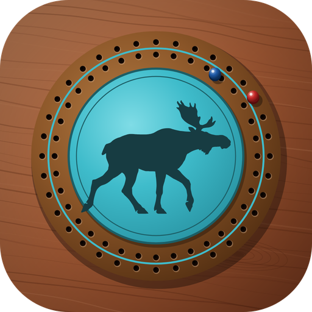</p>

<h1 align="center">Maine Cozy Cribbage</h1>

Two-player cribbage on hand-carved Maine boards, for Android phones and **foldables**. Play the computer, learn the
game with interactive lessons, or play friends live or turn by turn.

**[Download the latest APK](../../releases/latest)**: `MaineCozyCribbage-x.y.z-android.apk`. Once installed, the game
finds newer releases itself and offers **Update now** on its title screen.


| First launch | A guided game | The full tutor explains each step |
|---|---|---|
| 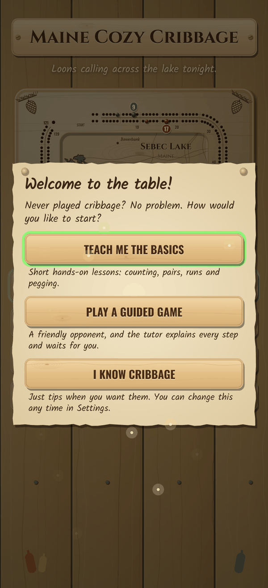 | 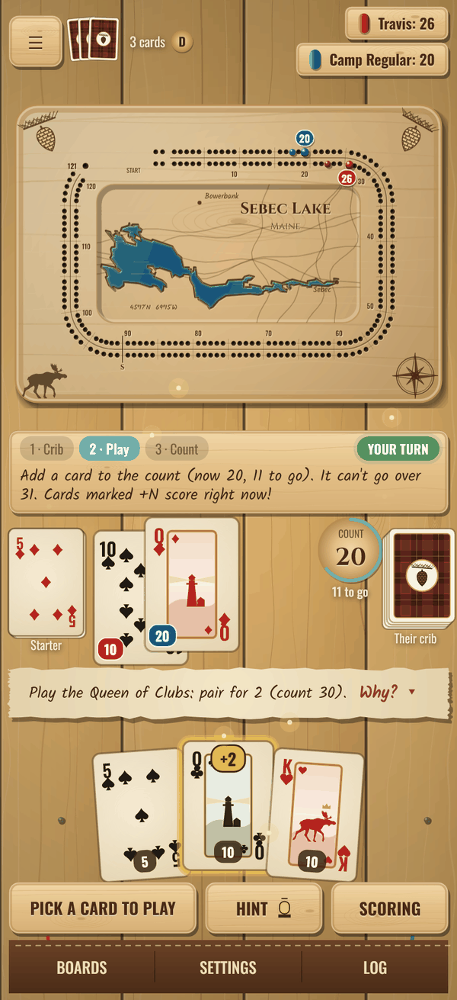 | 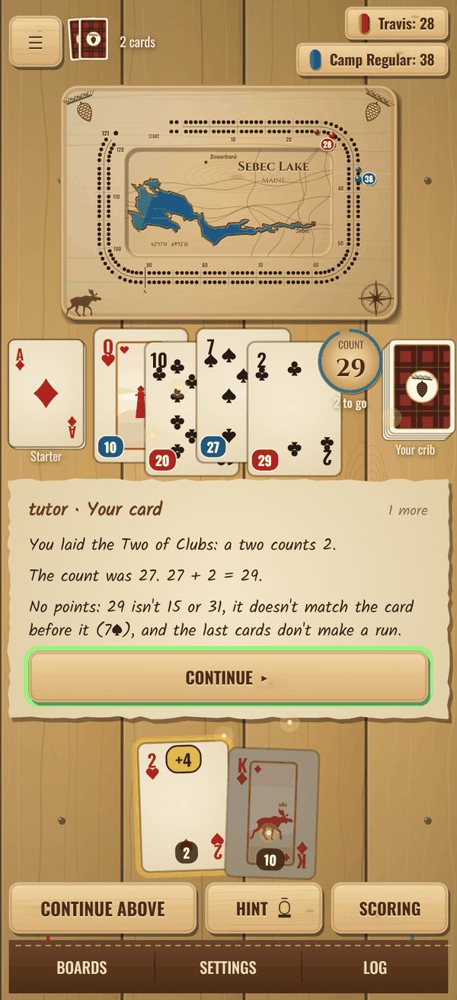 |

| Choosing crib cards | Counting the show | Scoring cheat sheet |
|---|---|---|
|  | 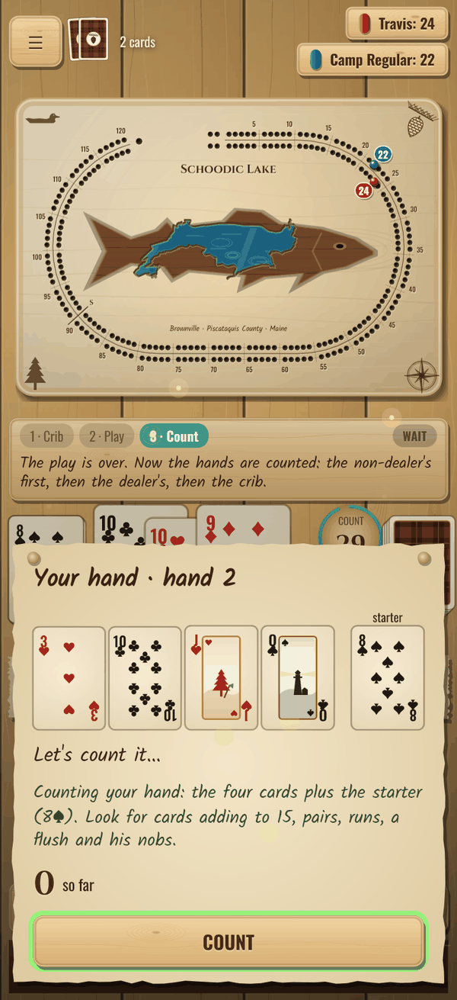 | 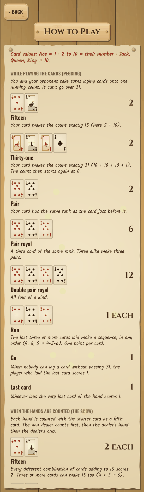 |

| Unfolded foldable | Half-folded (tabletop) |
|---|---|
|  |  |

| Christmas | Fourth of July | Blueberry season | Halloween |
|---|---|---|---|
|  |  | 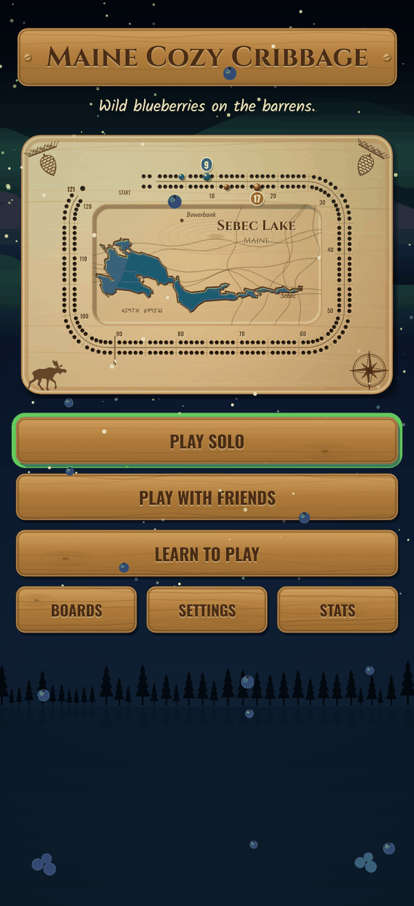 |  |

| Learn to play | Pegging lesson | Play with friends |
|---|---|---|
| 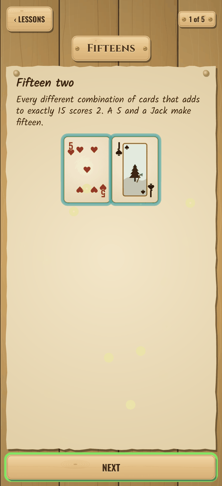 |  | 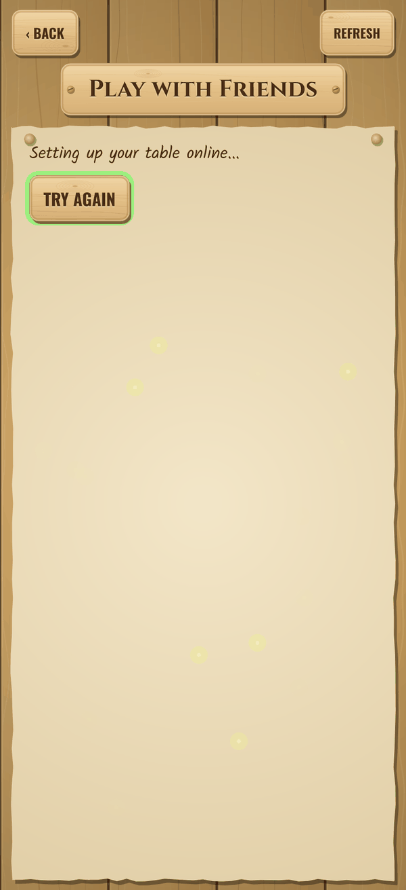 |

### The boards

| | |
|---|---|
|  **Sebec Lake** · hard maple, racetrack round the map |  **Moosehead Lake** · black cherry, oval track and a bull moose |
| 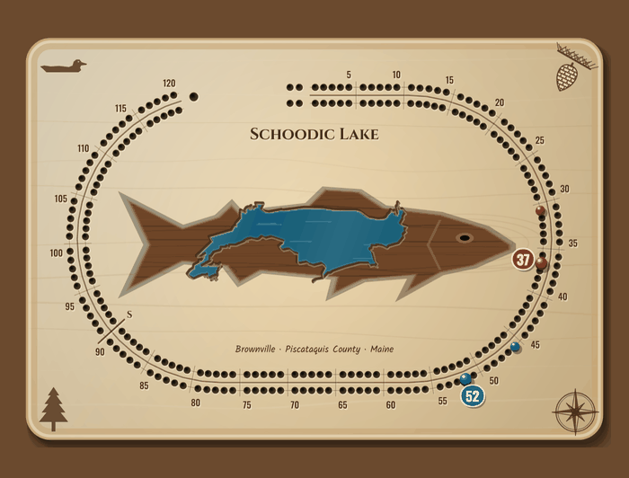 **Schoodic Lake** · the lake inside a walnut brook trout | 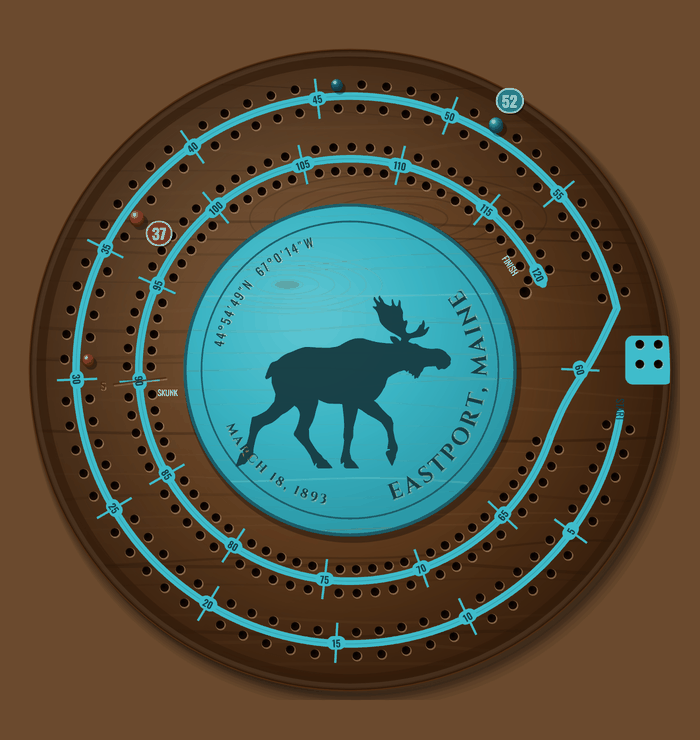 **Eastport** · round and teal, two rings of track |
|  **Rangeley Lake** · three streets under Saddleback | 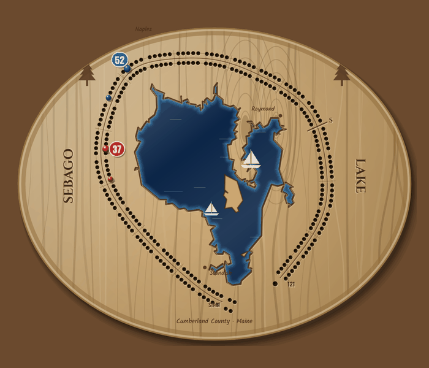 **Sebago Lake** · the track follows the shoreline |
| 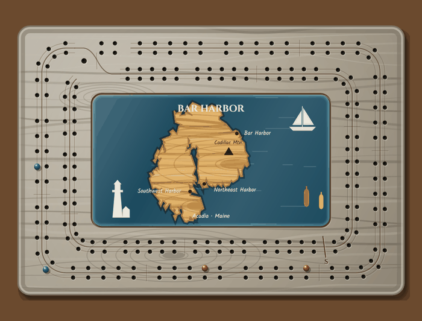 **Bar Harbor** · Mount Desert Island in a poured sea | 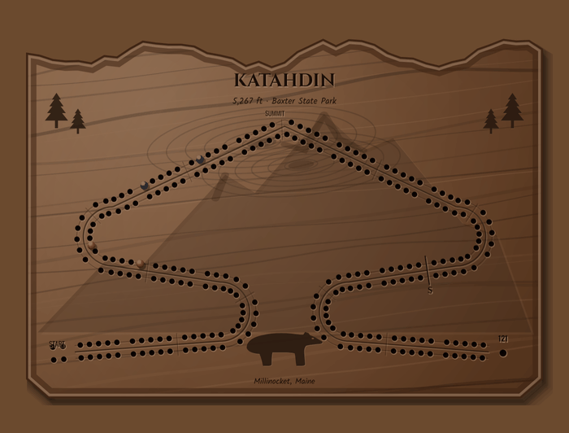 **Katahdin** · switchbacks to the summit |
| 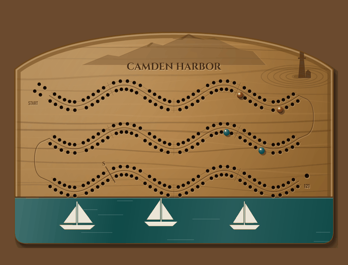 **Camden Harbor** · rolling waves and windjammers | 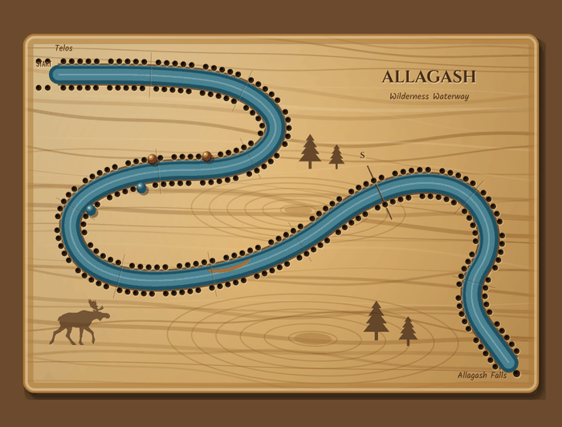 **Allagash Wilderness** · one bank each down the river |
| 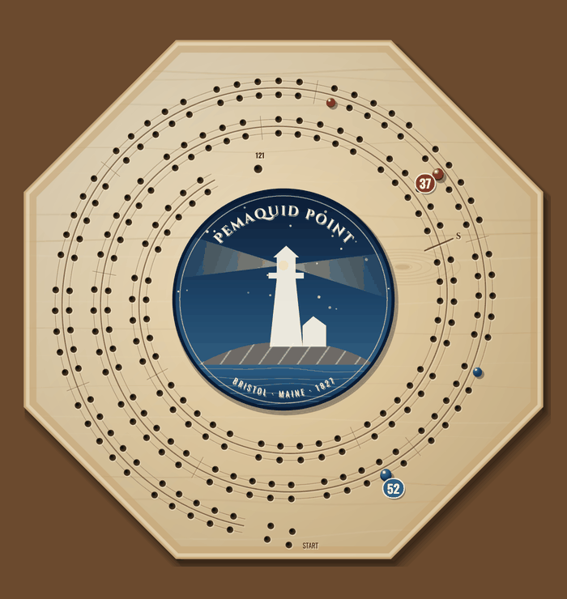 **Pemaquid Point** · eight-sided, spiralling in to the light | 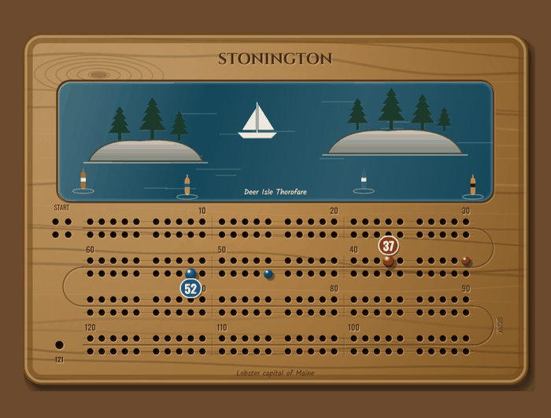 **Stonington** · four streets under the granite islands |
| 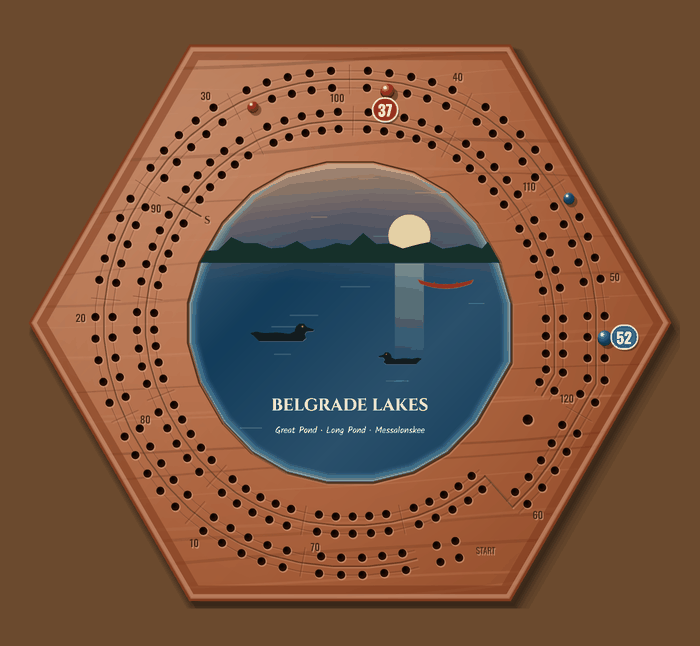 **Belgrade Lakes** · six-sided, two laps round a loon pond at dusk | 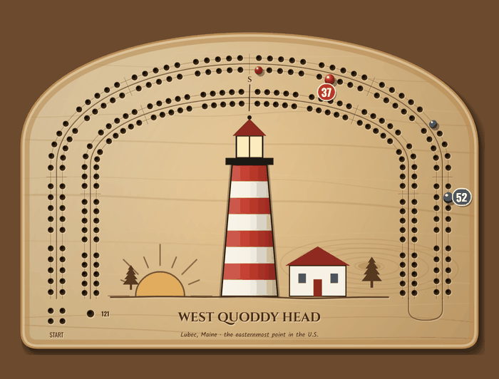 **West Quoddy Head** · a horseshoe round the candy-striped light |
| 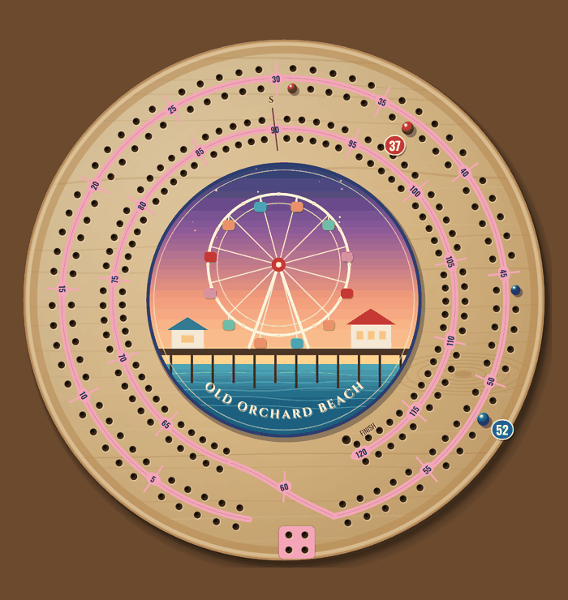 **Old Orchard Beach** · two laps round the Ferris wheel on the Pier | 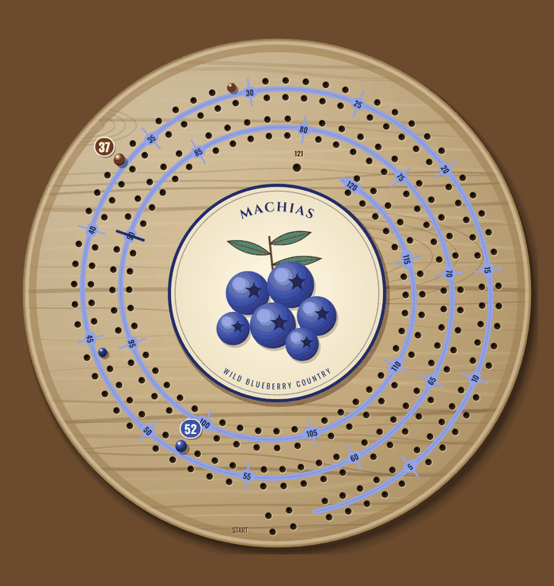 **Machias** · a blueberry-blue spiral in to a handful of wild blueberries |
| 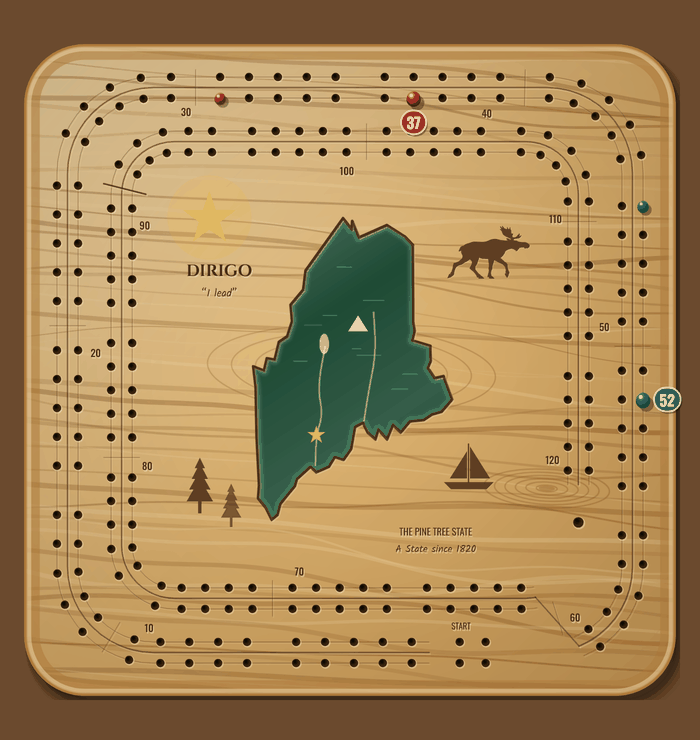 **Dirigo** · the whole state in spruce green under the North Star | |

All of these are rendered by the game's own code (`./gradlew :shared:desktopTest` writes them to `shared/build/screenshots`).

## What's in it

* **Seventeen boards, all Maine lakes and towns**: Sebec Lake, Moosehead Lake, Schoodic Lake (in a brook trout), Eastport
  (round and teal, after a real hand-made board), Rangeley Lake (three streets), Sebago Lake (the track follows its
  shoreline), Bar Harbor (Mount Desert Island raised out of a poured sea), Katahdin (switchbacks up the mountain),
  Camden Harbor (rolling waves and windjammers), the Allagash (one bank each), Pemaquid Point (a spiral in to the
  lighthouse), Stonington (four streets), Belgrade Lakes (a six-sided board, two laps round a loon pond), West
  Quoddy Head (a horseshoe round the candy-striped light), Old Orchard Beach (round the Ferris wheel), Machias (wild
  blueberries) and Dirigo (the whole state under the North Star). Lake and island shapes are the real
  ones, from OpenStreetMap. Fish jump in the lakes; pegs hop hole to hole, the holes
  just pegged glow, and thrown cards sail across to the crib.
* **Built for beginners:** a guide strip shows the step you're on (Crib, Play, Count), whose turn it is and what to do; cards that would score are marked **+N**; every card on the table carries the running count in the colour of whoever laid it; a ring fills towards 31; choosing crib cards tells you what the four you keep already score; a scoring cheat sheet shows every score with real cards; a first-launch welcome offers lessons or a guided game. With the helper on the game goes **one step at a time**: the computer holds its card until you tap Continue, so nothing changes while you're reading. Turn on **Peg it yourself** and you move your own peg (tap the glowing hole) whenever you score in the play.
* **Solo play** against three opponents: Summer Visitor, Camp Regular and Old-Timer (which weighs every starter and
  minds the crib).
* **Learn to play**: eight hands-on lessons (find the fifteens, count hands, choose discards, peg) plus endless
  counting and discard practice. A tutorial helper explains the best play during solo games.
* **Friends and multiplayer**, built like Refiner's Fire: a friend code for each player, friend requests, invitations,
  win/loss and skunk records, and table talk. The server deals and keeps every hand hidden; games carry on turn by
  turn, live when you're both in. A background check posts "your turn" notifications.
* **Nine table themes** (Pine Tavern, Flannel Cabin, Birch Morning, Harbor Fog, Loon Night, Acadia Sunrise, Blueberry Barrens, Lobster Shack, Grange Hall; stars twinkle, gulls glide, the harbor light turns) and **seasons and
  holidays that change on their own**: snow, mud season, fireflies, foliage, New Year, Valentine's, Maine Day & St.
  Patrick's, Maine Maple Sunday, Easter, the Fourth, blueberry season, Halloween, Thanksgiving and Christmas. Turn it
  off or pick one in Settings.
* **Soft music** (three synthesised waltzes, with a holiday version) and sounds, each with its own volume.
* **Foldables**: folded it's a phone layout that always fits the hand and the buttons; unfolded, a round board sits
  beside your hand and a long board runs the full width across the top; half-folded on a table, the board sits on
  top and your hand below. Tap the board any time to see it full-screen.

Every picture in the game (boards, cards, scenery, icons) is drawn in code; there are no image files.

## Project layout

| Path | |
|---|---|
| `shared/` | Kotlin Multiplatform + Compose: rules engine (`game/`), boards (`board/`), drawing (`gfx/`), themes, audio synthesis, online client, all screens (`ui/`) |
| `app/` | Android app: activity with fold tracking, audio engine, turn notifications, self-updater |
| `server/` | Cloudflare Worker: Hub Durable Object (accounts, friends, invites, records) and a Game Durable Object per game |
| `spec/scoring-vectors.json` | Scored hands and pegging piles both the app's and the server's rules are tested against |
| `tools/outlines/` | Turns OpenStreetMap lake polygons into the outlines in `gfx/Outlines.kt` |

## Building

Every push to `main` runs [`.github/workflows/build-apk.yml`](.github/workflows/build-apk.yml): tests, a signed release
APK, and a GitHub Release tagged `v<version>-build.<run>`. The app's update check compares that build number with its own.

Signing uses two repository secrets, `CRIBBAGE_KEYSTORE_B64` (the base64 keystore) and `CRIBBAGE_KEYSTORE_PASSWORD`.
Keep the keystore safe: Android only installs an update signed with the same key.

Locally (JDK 17+):

```bash
./gradlew :shared:desktopTest     # rules, AI, scoring parity, and offscreen renders in shared/build/screenshots
./gradlew :app:assembleDebug
```

## Server

```bash
cd server
npm ci
npm run test:rules               # the server's rules against spec/scoring-vectors.json
npm run dev & npm test           # end to end against a local Worker
npm run deploy                   # to Cloudflare (after npx wrangler login)
```

The app talks to `https://maine-cozy-cribbage.geoguy89.workers.dev` (`OnlineConfig` in `shared/.../net/Online.kt`).

| | |
|---|---|
| `POST /v1/register` | `{name}` → `{playerId, secret, friendCode}` |
| `GET /v1/sync` | me, friends with records, requests, invitations, games |
| `POST /v1/friends/request` · `respond` · `remove` | |
| `POST /v1/invite` · `invite/respond` · `invite/cancel` | an accepted invitation creates a game |
| `GET /v1/game/{id}` | your view of a game (the other hand, crib and deck hidden) |
| `POST /v1/game/{id}/action` | `{type: "discard", cards}` · `{type: "play", card}` · `{type: "resign"}` · `{type: "emote", id}` |
| `GET /v1/game/{id}/ws` | live views and table talk |

Requests carry `Authorization: Bearer <playerId>.<secret>`.

## Credits

Lake and island outlines © OpenStreetMap contributors (ODbL). Fonts: Cinzel, Kalam and Oswald, under the SIL Open
Font License (see `licenses/`).
